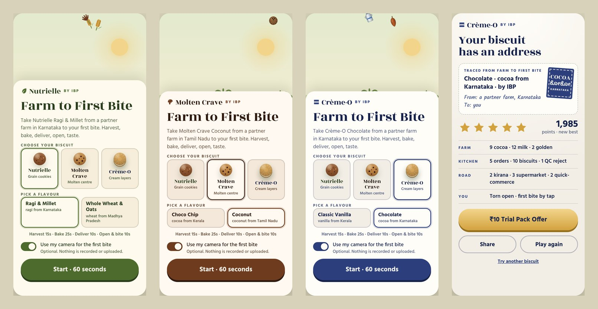
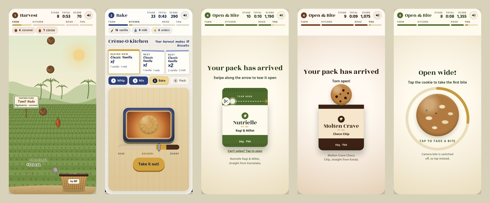

# Farm to First Bite

A 60-second phone game for IBP's three biscuits. Players pick **Nutrielle**, **Molten Crave** or **Crème-O** and one of two flavours. Then they harvest its ingredients on a partner farm, bake past quality control, drive the packs to the shops, tear the pack open and take the first bite. The game ends on a trial-pack offer.

It was made for IBP's launch press conference in *Baking a Strategic Mix 2026*, the Marketing Strategy & Innovation simulation in the GIM PGDM programme. A QR code on the event poster opens it on the audience's phones.

**Play it:** https://kaushikkamat.github.io/IBP-W2/



## Pick a biscuit

Each choice changes the farm, the ingredients, the first kitchen step, the cookie, the pack and the colours of the whole game.

| Biscuit | Flavour | Partner farm | You catch | Kitchen step 1 |
| --- | --- | --- | --- | --- |
| Nutrielle | Ragi & Millet | Karnataka | ragi and millet | Mill |
| Nutrielle | Whole Wheat & Oats | Madhya Pradesh | wheat and oats | Mill |
| Molten Crave | Choco Chip | Kerala | cocoa and wheat | Melt |
| Molten Crave | Coconut | Tamil Nadu | coconut and cocoa | Grate |
| Crème-O | Classic Vanilla | Kerala | vanilla and milk | Whip |
| Crème-O | Chocolate | Karnataka | cocoa and milk | Whip |

## How it plays

All four stages share one 60-second clock, and each stage feeds the next: what you catch is all the kitchen has to bake with, and every pack you seal rides on the truck.

| Stage | Time | What you do |
| --- | --- | --- |
| 1. Harvest | 15 s | Slide the basket to catch your flavour's two ingredients. A golden one counts as three. A stone knocks one out; husk just costs points. |
| 2. Bake | 25 s | Take each order through four stations (Mill, Melt, Grate or Whip first, then Mix, Bake and Pack). Pull the tray out while the marker is in the golden zone. An underbaked or burnt tray, or the wrong ingredient, gets the QC stamp: *"Only perfect cookies leave an IBP kitchen."* |
| 3. Deliver | 10 s | Swipe between three lanes. Drive over the Kirana, Supermarket and Quick-Commerce drops and miss the potholes. |
| 4. Open & Bite | 10 s | Your pack arrives. Swipe from the scissors along the arrow to tear it open, and the camera opens: open wide, or tap, for the first bite. If the pack is still shut with 5 seconds left, it opens for you. |

The end card reads like a label, for example **Ragi & Millet · ragi from Karnataka · by IBP**. It shows a star rating, Share, the brand's **Trial Pack Offer** (₹45 Nutrielle, ₹60 Molten Crave, ₹10 Crème-O) and a link to try another biscuit.



**Controls.** On a phone you slide, tap and swipe. On a laptop the mouse does the same jobs, including dragging along the tear line, and the arrow keys move the basket and the truck. The clock stops during each stage's intro card, while the tab is in the background and while the phone is turned sideways.

### Scoring

| Action | Points |
| --- | --- |
| Ingredient caught | +10 |
| Golden ingredient | +40 |
| Stone / husk | −15 / −5 |
| Order packed | +100 per cookie, plus 50 if packed within 6 s of starting it (25 within 9 s) |
| Kitchen cleared early | +5 for each second left |
| Pack delivered / pothole | +60 / −20 |
| Pack torn open | +40 by swiping, +25 with the button |
| First bite | +100 by camera, +60 by tap, +30 if time runs out |

Everyone starts on one star and earns another at 400, 800, 1,200 and 1,600 points. The best score is kept on the phone.

## Update the live game

The site is served by GitHub Pages from the `main` branch, so the link and the poster's QR code never change.

1. On the repository page, click **Add file → Upload files**.
2. Drag in what's inside this folder (`index.html`, `README.md` and the `screenshots` folder). Files with the same names are replaced.
3. Click **Commit changes**. The live game updates within a few minutes.

Before the event, scan the QR with an iPhone and an Android phone over the venue Wi-Fi.

If you'd rather use git, from a clone of this repository:

```bash
git add index.html README.md screenshots
git commit -m "Pick a biscuit and tear open the pack"
git push
```

## Record the press-conference clip

Add `#demo` to the end of the address, pick a biscuit and press **Start demo**: the game plays itself. It catches ingredients, works the kitchen, burns one tray on purpose (when there's enough to spare) so the QC stamp shows, drives the route, tears the pack open and takes the bite. Switch the camera off first if you'd rather keep your face out of the clip.

## Run it on your computer

There's no build step: open `index.html` in a browser. To try the camera bite on your own machine, serve the folder instead, because browsers only allow the camera on https pages or localhost:

```bash
python3 -m http.server 8000
```

On Windows the command is `python -m http.server 8000`. Then go to http://localhost:8000.

## Change things

Everything lives in `index.html`. The settings you're most likely to change sit together at the top of the script:

| Constant | Controls |
| --- | --- |
| `BRANDS` | Each biscuit's name, price, offer code and pack colours, and its two flavours: the farm, the local word on the sign, the two ingredients, the wrong options at the Mix station and the cookie's colours |
| `ITEMS` | The ingredients the farms grow, with their words and colours |
| `TOOLS` | The first kitchen station for each flavour: Mill, Melt, Grate or Whip |
| `STAGES` | Stage names and lengths in seconds |
| `STORES` | The three delivery stops |
| `RATING_STEPS` | Points needed for two, three, four and five stars |

It's plain HTML, CSS and JavaScript with no libraries. The farm and the road are drawn on a canvas, the kitchen, the pack and the end card are ordinary page elements, and every sound is synthesised with the Web Audio API, so there are no audio files. The only outside request is for Google Fonts (Rozha One, Hind and Kalam); offline, the game falls back to system fonts.

## Privacy and accessibility

- The camera is optional. Players can switch it off on the start screen, and the game asks for permission before the clock starts.
- To spot an open mouth, the game shrinks each camera frame to 48 × 36 pixels on the phone. Nothing is recorded, stored or uploaded, and the camera turns off right after the bite.
- Only the best score, the last biscuit picked and the sound and camera settings are saved, in the browser's local storage. There's no analytics or tracking.
- The biscuit and flavour picker uses ordinary radio buttons. The kitchen stations, the bite, the offer and Share are ordinary buttons, and "Can't swipe? Tap to open" opens the pack without a swipe. Stage starts, QC rejects and the final score are read out to screen readers, and the game follows the phone's reduce-motion setting.

## About

IBP (Indian Biscuit Products Ltd), Nutrielle, Molten Crave and Crème-O are fictional brands from a classroom simulation. They have no link to any real company. The partner-farm states are part of the campaign story, not sourcing claims, and the offers and codes are a demo, not a real promotion.
